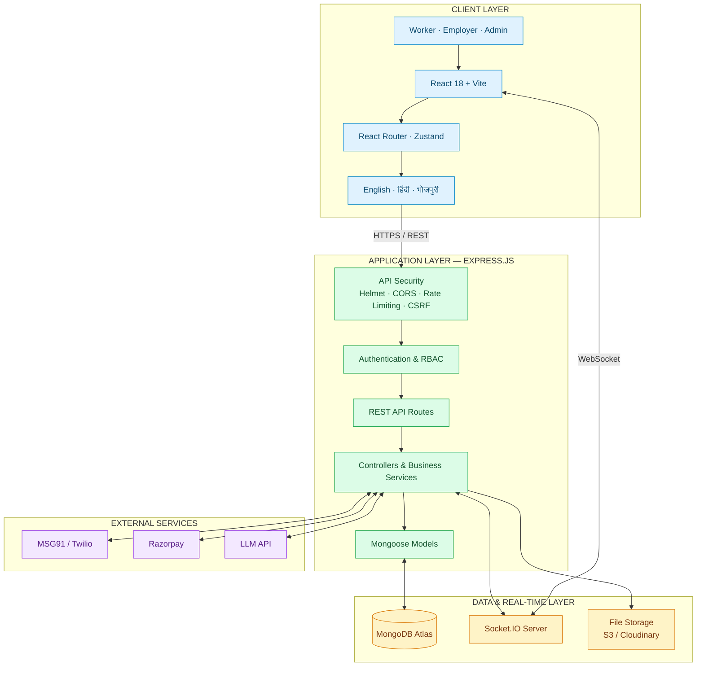
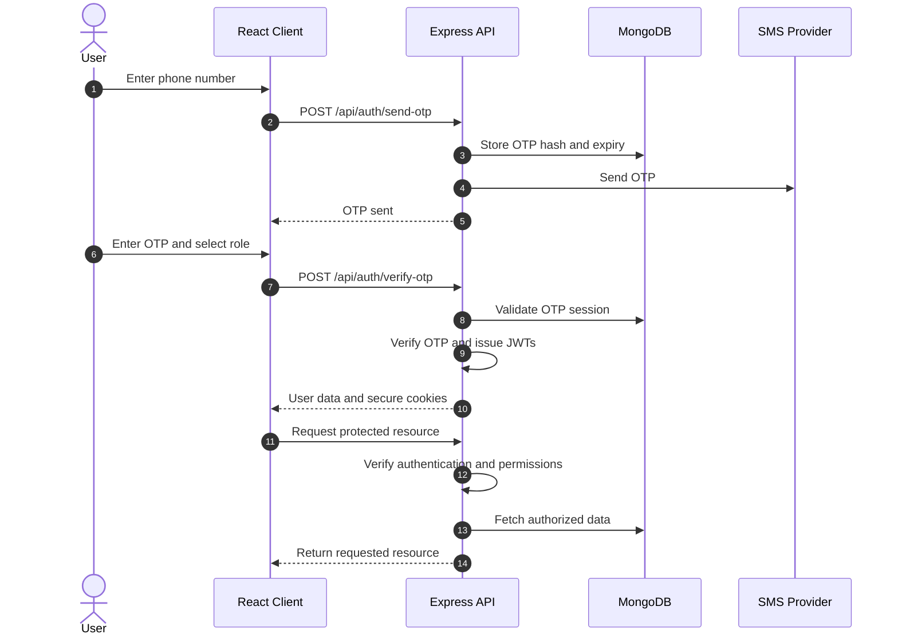
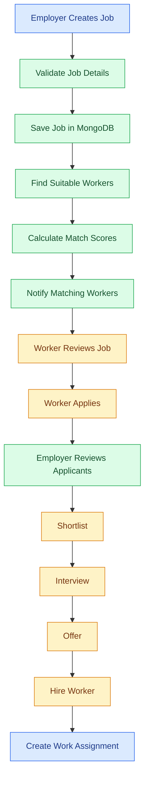
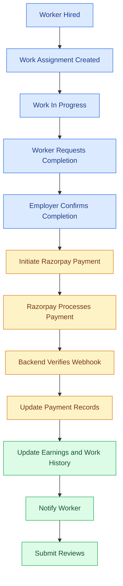
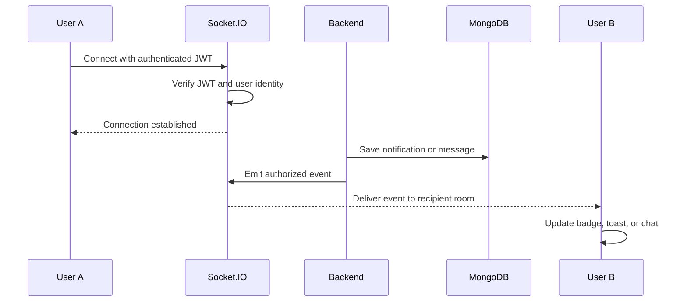
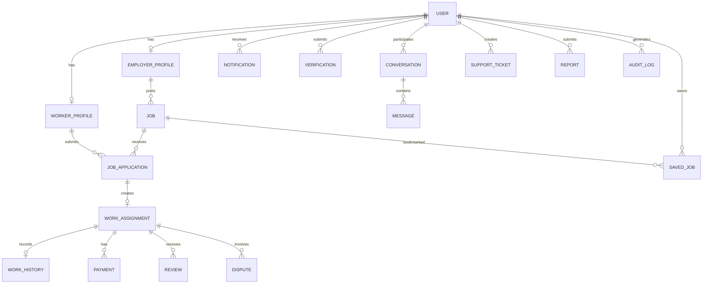

# ShramSetu — Find Work Directly, Hire Directly

### श्रमसेतु — सीधे काम पाएँ। सीधे काम दें।

**A trusted, commission-free direct-work marketplace for daily-wage and short-term workers in India.**

ShramSetu connects workers directly with employers through verified digital identities, location-based job matching, transparent hiring, real-time communication, and digital payments.

No middlemen. No commission on worker wages. More opportunities. Greater trust.

<p align="center">
  
  
  
  
  
  
</p>

---

## Table of Contents

- [Overview](#overview)
- [Problem Statement](#problem-statement)
- [Key Features](#key-features)
- [Technology Stack](#technology-stack)
- [System Architecture](#system-architecture)
- [Application Workflows](#application-workflows)
- [Database Design](#database-design)
- [Project Structure](#project-structure)
- [API Overview](#api-overview)
- [Security](#security)
- [Getting Started](#getting-started)
- [Environment Configuration](#environment-configuration)
- [Deployment](#deployment)
- [Roadmap](#roadmap)
- [Contributing](#contributing)
- [License](#license)

---

## Overview

ShramSetu is designed for India's informal workforce, including drivers, cooks, plumbers, masons, delivery workers, helpers, and security guards.

The platform enables workers to discover nearby jobs, apply directly, build a digital work history, and establish a professional reputation. Employers can publish jobs, find suitable candidates, manage hiring, and process payments through an integrated workflow.

### The Problem

- Workers depend on middlemen and may lose part of their earnings to commissions.
- Informal workers lack a portable digital identity and verifiable work history.
- Employers struggle to find reliable workers quickly.
- Language and digital-literacy barriers make existing platforms difficult to use.

### The Solution

- Direct worker-to-employer connections.
- Zero platform commission on worker wages.
- Verified worker and employer profiles.
- Location-based job discovery and candidate matching.
- Voice-first accessibility in English, Hindi, and Bhojpuri.
- Transparent hiring, payment records, and two-way reviews.

---

## Key Features

### 👷 Worker Platform

- Phone-based OTP authentication.
- Guided profile creation with voice assistance.
- Digital Worker ID and identity-verification workflow.
- Nearby job discovery with ranked matching.
- Voice search and multilingual interface.
- One-tap applications and saved jobs.
- Application tracking and real-time notifications.
- In-app messaging.
- Earnings dashboard and work history.
- Two-way reviews and reputation tracking.
- Support tickets and dispute reporting.

### 🏢 Employer Platform

- Business and individual accounts.
- Adaptive profile and verification workflows.
- Five-step job posting with GPS-based location.
- Candidate Match Center.
- Hiring pipeline: Applied → Shortlisted → Interview → Offer → Hired.
- Work assignment and completion tracking.
- Razorpay payment integration.
- Worker reviews and payment history.

### 🛡️ Admin Platform

- Analytics dashboard.
- Worker and employer verification management.
- User suspension and activation.
- Job and payment moderation.
- Reports and dispute resolution.
- Administrative audit logs.

### 🌐 Platform Capabilities

- JWT authentication with HTTP-only cookies.
- Role-based access control and CSRF protection.
- Socket.IO notifications and chat.
- English, Hindi, and Bhojpuri localization.
- Web Speech API voice search and text-to-speech.
- LLM-powered support chatbot.
- Secure file-upload workflows.
- Mobile-first, PWA-ready frontend.

---

## Technology Stack

| Layer | Technologies |
|---|---|
| Frontend | React 18, Vite, Tailwind CSS |
| Routing and state | React Router v6, Zustand |
| Localization | i18next, react-i18next |
| Backend | Node.js 18+, Express.js |
| Database | MongoDB, Mongoose |
| Authentication | JWT, HTTP-only cookies, CSRF |
| Real-time | Socket.IO |
| Voice | Web Speech API |
| Payments | Razorpay |
| SMS and OTP | MSG91 / Twilio |
| File storage | Multer, AWS S3 / Cloudinary |
| AI | OpenAI-compatible LLM API |
| Frontend hosting | Vercel / Netlify |
| Backend hosting | Render / Railway |
| Database hosting | MongoDB Atlas |

---

## System Architecture

ShramSetu follows a layered architecture that separates the user interface, API and business logic, database, real-time communication, and external integrations.



### Architecture Responsibilities

| Component | Responsibility |
|---|---|
| React frontend | User interfaces, dashboards, forms, and navigation |
| Express API | Request handling, business logic, and authorization |
| MongoDB | User profiles, jobs, applications, assignments, and records |
| Socket.IO | Real-time notifications, messaging, and status updates |
| External services | OTP delivery, payments, file storage, and AI responses |

---

## Application Workflows

### 1. Authentication Flow

Phone-based OTP authentication provides passwordless access to the platform.



### 2. Job Discovery and Hiring Flow

The employer publishes a job, the matching engine ranks suitable workers, and the employer manages applicants through the hiring pipeline.



**Matching factors:**

- Skills and experience.
- Geographic distance.
- Availability.
- Worker ratings.
- Verification status.

### 3. Job Completion and Payment Flow



Payment confirmation must rely on verified server-side payment events. A client-side checkout callback alone is not sufficient to establish that payment succeeded.

### 4. Real-Time Notifications and Chat



Socket.IO supports personal notification rooms and conversation rooms. The server must verify user identity and conversation membership before permitting access.

### 5. AI Chatbot Flow

```mermaid
flowchart LR
    A["User Voice or Text Query"] --> B["AI Chat API"]
    B --> C["Intent Detection"]
    C --> D["Retrieve Relevant App Data"]
    D --> E["Build Context"]
    E --> F["LLM API"]
    F --> G["Localized Response"]
    G --> H["Display or Speak Response"]

    classDef input fill:#DBEAFE,stroke:#2563EB,color:#1E3A8A
    classDef process fill:#F3E8FF,stroke:#9333EA,color:#581C87
    classDef output fill:#DCFCE7,stroke:#16A34A,color:#14532D

    class A input
    class B,C,D,E,F process
    class G,H output
```



The chatbot can combine relevant application data with an LLM-generated response and use browser-based text-to-speech for spoken output.

---

## Database Design

MongoDB stores the platform's core entities and their relationships.



### Core Data Models

| Model | Purpose |
|---|---|
| `User` | Authentication, roles, language, and account status |
| `WorkerProfile` | Skills, experience, location, ratings, and verification |
| `EmployerProfile` | Account type, business details, and verification |
| `Job` | Job description, location, pay, schedule, and status |
| `JobApplication` | Applications and match scores |
| `WorkAssignment` | Hired work and completion status |
| `WorkHistory` | Completed work and earnings history |
| `Payment` / `Transaction` | Payment and transaction records |
| `Review` | Worker and employer ratings |
| `Conversation` / `Message` | In-app messaging |
| `Notification` | Real-time and stored alerts |
| `Verification` | Identity and business verification |
| `SupportTicket` / `Report` / `Dispute` | Support and moderation |
| `AuditLog` | Administrative activity |
| `OTPSession` | OTP expiry and verification lifecycle |
| `SavedJob` | Bookmarked jobs |

**Database capabilities:** Geospatial indexes (`2dsphere`), text indexes, and TTL indexes for expiring OTP sessions.

---

## Project Structure

```text
shramsetu/
├── client/
│   ├── public/
│   ├── src/
│   │   ├── components/
│   │   │   ├── ui/
│   │   │   ├── layout/
│   │   │   ├── LanguageSwitcher.jsx
│   │   │   └── VoiceSearchModal.jsx
│   │   ├── hooks/
│   │   │   ├── useSocket.js
│   │   │   └── useVoice.js
│   │   ├── layouts/
│   │   ├── locales/
│   │   │   ├── en.json
│   │   │   ├── hi.json
│   │   │   └── bho.json
│   │   ├── pages/
│   │   │   ├── public/
│   │   │   ├── auth/
│   │   │   ├── worker/
│   │   │   ├── employer/
│   │   │   ├── admin/
│   │   │   └── shared/
│   │   ├── services/
│   │   │   └── api.js
│   │   ├── store/
│   │   ├── utils/
│   │   ├── App.jsx
│   │   ├── main.jsx
│   │   ├── i18n.js
│   │   └── index.css
│   ├── index.html
│   ├── package.json
│   └── vite.config.js
│
└── server/
    ├── scripts/
    │   ├── seed.js
    │   └── seedData.js
    ├── src/
    │   ├── config/
    │   ├── controllers/
    │   ├── middleware/
    │   ├── models/
    │   ├── routes/
    │   ├── services/
    │   ├── sockets/
    │   ├── validators/
    │   ├── utils/
    │   ├── app.js
    │   └── server.js
    ├── .env.example
    └── package.json
```

The frontend is organized by user role and reusable components. The backend separates routes, controllers, services, middleware, database models, and real-time socket handlers.

---

## API Overview

All REST endpoints use the `/api` prefix.

| Module | Representative Endpoints |
|---|---|
| Authentication | `/auth/send-otp`, `/auth/verify-otp`, `/auth/me` |
| Workers | `/workers/me`, `/workers/me/history`, `/workers/me/earnings` |
| Employers | `/employers/me`, `/employers/me/verification` |
| Jobs | `/jobs`, `/jobs/matched`, `/jobs/:id/apply` |
| Applications | `/applications`, `/applications/:id/hire` |
| Assignments | `/assignments`, `/assignments/:id/complete` |
| Reviews | `/reviews`, `/reviews/workers/:id` |
| Payments | `/payments/initiate`, `/payments/webhook` |
| Messaging | `/messages/conversations` |
| Notifications | `/notifications` |
| Support | `/support/tickets`, `/reports` |
| AI | `/ai/chat` |
| Admin | `/admin/users`, `/admin/analytics`, `/admin/verifications` |
| Uploads | `/uploads/single`, `/uploads/multiple` |

Refer to the backend route files for the complete endpoint list, HTTP methods, request schemas, and authorization rules.

---

## Security

ShramSetu incorporates the following security mechanisms:

- **Authentication:** JWT access and refresh tokens.
- **Cookie security:** HTTP-only authentication cookies.
- **CSRF protection:** Double-submit cookie and request-header validation.
- **Authorization:** Server-side role-based access control.
- **API protection:** Helmet, CORS allowlisting, and rate limiting.
- **Input validation:** Request validation and input sanitization.
- **Payment security:** Razorpay webhook signature verification.
- **File security:** Upload restrictions and file-size limits.
- **Sensitive data:** Restricted access to Aadhaar and bank details.
- **Auditability:** Administrative action logging.
- **Session control:** Session-version-based invalidation.

Production deployment requires strong secrets, HTTPS, restricted database access, disabled development bypasses, and appropriate protection of identity documents.

---

## Getting Started

### Prerequisites

- Node.js 18+
- MongoDB 6+ or MongoDB Atlas
- npm
- Git

### 1. Clone the Repository

Replace the placeholder URL with your actual GitHub repository.

```bash
git clone https://github.com/your-org/shramsetu.git
cd shramsetu
```

### 2. Install Dependencies

```bash
cd server
npm install

cd ../client
npm install
```

### 3. Configure Environment Variables

Create backend and frontend environment files:

```bash
cd server
cp .env.example .env
```

Create `client/.env` containing the frontend configuration shown below.

On Windows PowerShell, use `Copy-Item .env.example .env` when needed.

### 4. Configure MongoDB

For local development:

```env
MONGO_URI=mongodb://localhost:27017/shramsetu
```

Alternatively, configure your MongoDB Atlas connection string.

### 5. Start the Backend

```bash
cd server
npm run dev
```

Backend URL: `http://localhost:5000`

### 6. Start the Frontend

In a second terminal:

```bash
cd client
npm run dev
```

Frontend URL: `http://localhost:5173`

### 7. Seed Development Data

If the seed scripts are available in your repository:

```bash
cd server
npm run seed:admin 9876543210
npm run seed:data
```

Use only development data and test credentials locally. Verify the seed scripts and available npm commands against your actual `package.json` files.

---

## Environment Configuration

### Backend — `server/.env`

```env
PORT=5000
NODE_ENV=development
CLIENT_URL=http://localhost:5173

MONGO_URI=mongodb://localhost:27017/shramsetu

JWT_SECRET=replace_with_a_strong_random_secret
JWT_REFRESH_SECRET=replace_with_a_different_random_secret
JWT_EXPIRES_IN=15m
JWT_REFRESH_EXPIRES_IN=7d

OTP_EXPIRY_MINUTES=5
OTP_MAX_ATTEMPTS=5
OTP_RESEND_COOLDOWN_SECONDS=60

SMS_PROVIDER=console
MSG91_AUTH_KEY=
MSG91_TEMPLATE_ID=
TWILIO_ACCOUNT_SID=
TWILIO_AUTH_TOKEN=
TWILIO_FROM=

STORAGE_DRIVER=local
AWS_REGION=ap-south-1
AWS_ACCESS_KEY_ID=
AWS_SECRET_ACCESS_KEY=
AWS_S3_BUCKET=

RAZORPAY_KEY_ID=
RAZORPAY_KEY_SECRET=
RAZORPAY_WEBHOOK_SECRET=

LLM_API_KEY=
LLM_API_URL=https://api.openai.com/v1/chat/completions

FACE_VERIFICATION_ENABLED=false
```

### Frontend — `client/.env`

```env
VITE_API_URL=http://localhost:5000/api
VITE_SOCKET_URL=http://localhost:5000
```

Use your actual service credentials when enabling SMS, payments, file storage, or AI. Never commit real secrets or production `.env` files to GitHub.

---

## Deployment

### Frontend — Vercel

1. Import the repository into Vercel.
2. Configure `client` as the frontend root directory.
3. Build the Vite application.
4. Configure the production environment variables.

```env
VITE_API_URL=https://your-api.onrender.com/api
VITE_SOCKET_URL=https://your-api.onrender.com
```

### Backend — Render / Railway

1. Connect the repository to your hosting provider.
2. Configure `server` as the service root directory.
3. Install dependencies with `npm install`.
4. Start the application using `npm start`.
5. Configure the production environment variables.
6. Set `CLIENT_URL` to the deployed frontend URL.

### Database — MongoDB Atlas

1. Create a cluster.
2. Configure database credentials and network access.
3. Set `MONGO_URI` in the backend environment.
4. Verify the deployed database connection.
5. Configure backups and access permissions.

### Production Checklist

- [ ] Production SMS provider configured.
- [ ] Razorpay credentials and webhook verified.
- [ ] Strong JWT secrets configured.
- [ ] CORS and frontend origin configured.
- [ ] HTTPS enabled.
- [ ] Development login bypass disabled.
- [ ] Database backups enabled.
- [ ] File-upload and authorization checks tested.
- [ ] Socket.IO authentication tested.
- [ ] Error tracking configured.

---

## Roadmap

### Completed in the Project Specification

- [x] OTP authentication and RBAC.
- [x] Worker and employer profile workflows.
- [x] Job posting and matching.
- [x] Applications and hiring pipeline.
- [x] Work assignments and completion tracking.
- [x] Reviews and reputation.
- [x] Razorpay payment architecture.
- [x] Real-time notifications and chat.
- [x] Support and dispute workflows.
- [x] Admin dashboard and audit logs.
- [x] AI chatbot and voice search.
- [x] English, Hindi, and Bhojpuri localization.

### In Progress

- [ ] Production SMS integration.
- [ ] Razorpay live-mode configuration.
- [ ] PWA icons and offline shell.

### Planned

- [ ] Aadhaar-to-selfie face verification.
- [ ] Device fingerprinting and anti-fraud measures.
- [ ] Instant worker payouts.
- [ ] Escrow payments.
- [ ] WhatsApp job notifications.
- [ ] IVR support for non-smartphone users.
- [ ] Bulk hiring for up to 50 workers.
- [ ] Recurring jobs.
- [ ] Worker referrals.
- [ ] Hindi skill-training modules.
- [ ] Expansion to Delhi, Mumbai, and Pune.

*Update roadmap status according to the features actually implemented and tested in the repository.*

---

## Contributing

Contributions from developers, designers, and anyone interested in improving access to fair employment are welcome.

1. Fork the repository.
2. Create a feature branch.
3. Implement and test your changes.
4. Commit your changes.
5. Push the branch and open a Pull Request.

```bash
git checkout -b feature/your-feature
git add .
git commit -m "Add your feature"
git push origin feature/your-feature
```

Follow the project's contribution guidelines and never include credentials or sensitive personal information in commits.

---

## License

This project is licensed under the **MIT License**. See [LICENSE](LICENSE) for details.

---

## Contact

- **Website:** [shramsetu.in](https://shramsetu.in)
- **Email:** [hello@shramsetu.in](mailto:hello@shramsetu.in)
- **Twitter:** [@shramsetu](https://twitter.com/shramsetu)
- **GitHub:** [github.com/shramsetu](https://github.com/shramsetu)

Replace these links with the official project URLs if your repository uses different contact details.

---

<p align="center">
  <strong>ShramSetu — Find Work Directly. Hire Directly.</strong>
  <br />
  <em>श्रमसेतु — सीधे काम पाएँ। सीधे काम दें।</em>
  <br /><br />
  Building a more accessible, transparent, and trusted future for India's workforce.
</p>
